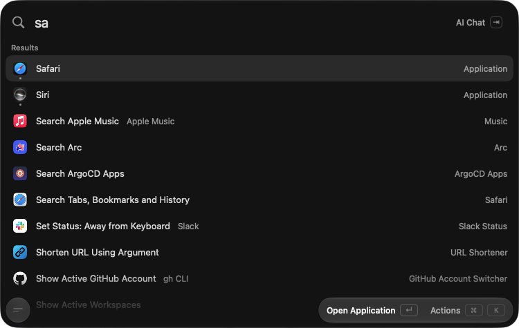
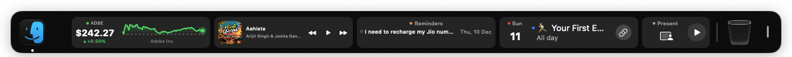
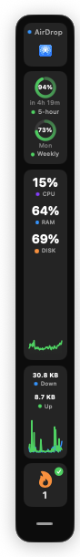
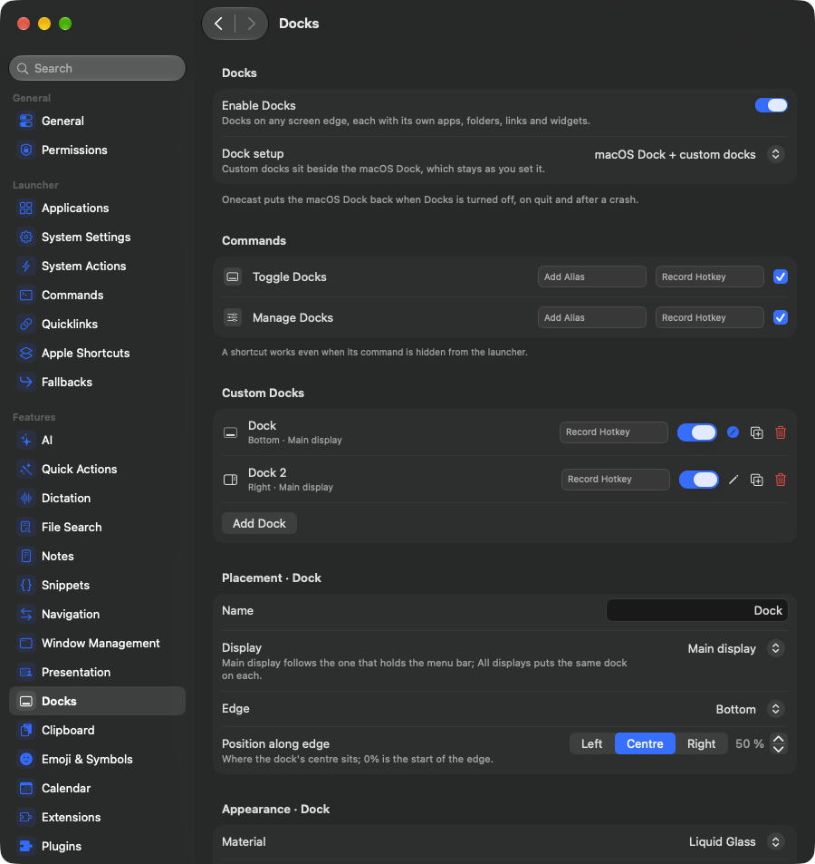
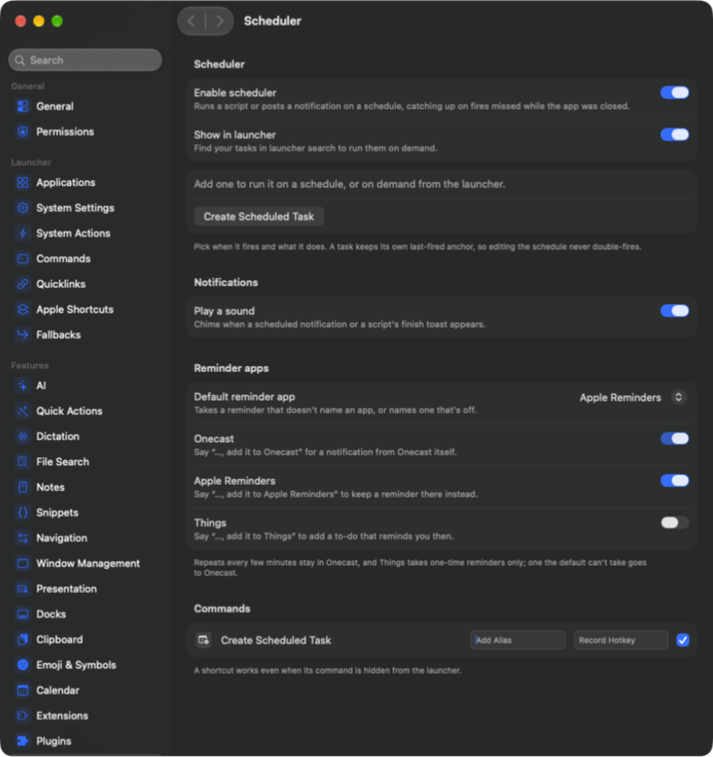
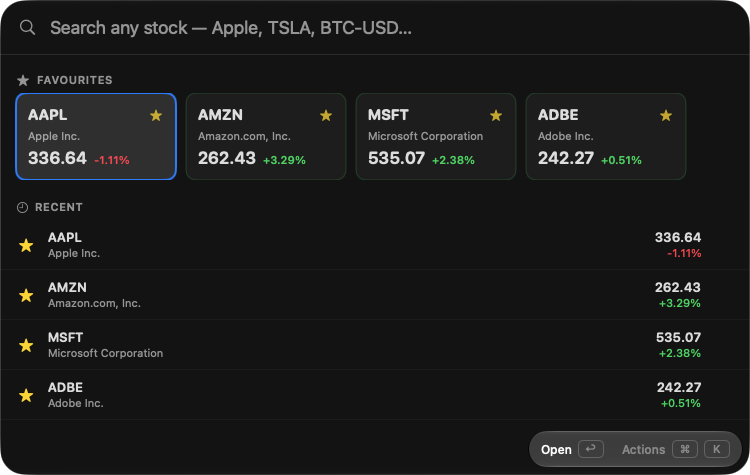
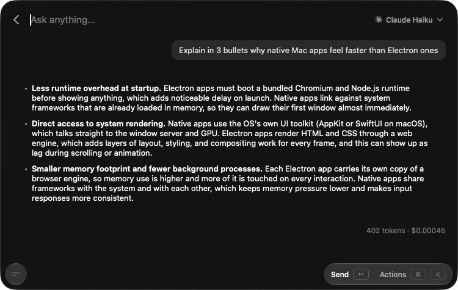
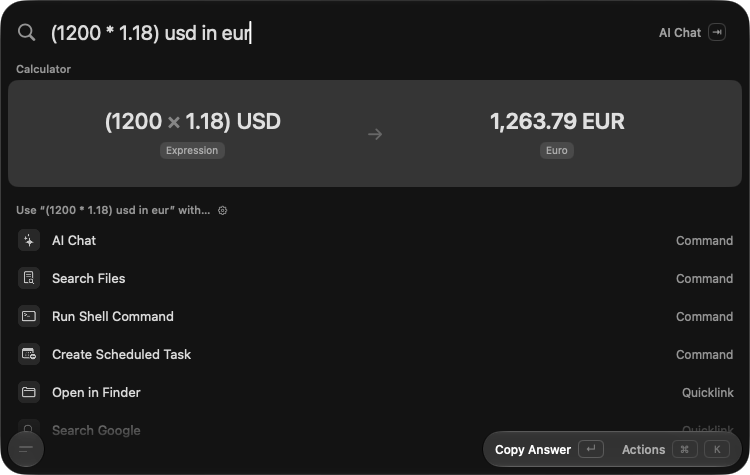
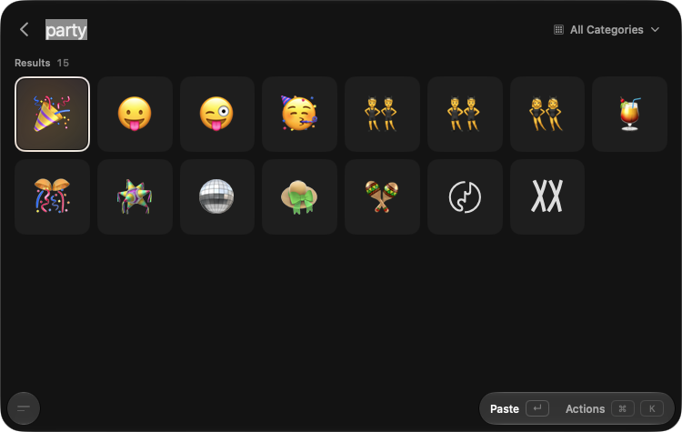

<h1 align="center">Onecast</h1>

<p align="center">
  <b>One keystroke for everything on your Mac.</b><br>
  A launcher, an AI cockpit, custom docks with live widgets, a plain-English scheduler and a native
  Swift plugin runtime: one fast, native app.
</p>

<p align="center">
  <a href="https://github.com/jhasubhash/onecast/releases/latest">
    </a>
  
  
  
  <a href="LICENSE">
    </a>
</p>

<p align="center">
  <a href="https://www.buymeacoffee.com/subhashjha"></a>
</p>

<p align="center">
  
</p>

<p align="center">
  
</p>

<p align="center">
  <code>brew install --cask jhasubhash/onecast/onecast</code>
</p>

Onecast is built with SwiftUI and AppKit, with **zero third-party dependencies**. There's no Electron
and no telemetry, and it stays comfortably under 100 MB of RAM. It runs the **Raycast extensions** you
already use and adds the things a launcher usually can't do: docks you design yourself, widgets you
can write in Swift, assistants you summon by name, and reminders you type the way you'd say them.

---

## 🧱 Docks, as many as you want

<table>
<tr>
<td width="80" valign="top"></td>
<td valign="top">

Onecast draws its **own docks**, on any edge of any display, **several at once**: a bottom dock for
apps, a side rail of widgets, one per monitor. Keep the macOS Dock next to them, or let Onecast take
over and hide it, with your settings restored when you switch back.

- **Liquid Glass plates** with real magnification, auto-hide, drag and drop, and a lens that grows
  from the centre just like the system Dock.
- **Apps, folders, files, links, Shortcuts, spacers and the Trash**, plus running apps and
  minimized windows with live previews and unread badges.
- **Layouts and setups.** Swipe or ⌘-scroll a dock through its layouts. A *setup* switches every
  dock and the macOS Dock at once, from a hotkey, the launcher, a `onecast://` link or a
  **Focus filter**: work, home and presenting each get their own Mac.

</td>
</tr>
</table>

### 📊 DockWidgets

Live tiles that sit right in a dock. **21 ship built-in**, and anyone can write more in Swift
against `OnecastPluginKit`:

| | |
| --- | --- |
| ⏱ **Time** | Clock · World Clock · Focus Timer · Stopwatch · Countdown · Alarm · Time Progress |
| ✅ **Productivity** | Calendar · Reminders · Sticky Note · Shortcut · AirDrop · Presentation |
| 🖥 **System** | Now Playing · Battery · System Activity · Network Activity |
| 💧 **Personal** | Hydration · Weather · AI Usage (Claude Code, Codex, Copilot limits) · Stock · Watchlist |

<p align="center">
  
</p>

---

## ⏰ A scheduler that speaks English

Type **"remind me to stretch every weekday at 4pm"** into the launcher and press ↵. That's it.

- An **on-device parser** reads *"in 20 minutes"*, *"tomorrow at 9"* and *"every Monday"*, and
  an AI fallback handles everything else.
- **Pick where reminders live.** Onecast notifications, **Apple Reminders** or **Things**, with a
  default of your choice. Say *"…and add it to Things"* to send one somewhere specific.
- **Scheduled scripts** run shell commands on a rule, and catch up on fires missed while the app
  was closed.
- Your AI assistants can schedule things for you too, with on-device tool calling.

<p align="center">
  
</p>

---

## 🧩 Native Swift plugins

When the JavaScript extension API isn't enough, write a **compiled SwiftUI plugin**. Onecast builds
and loads it straight into the palette with full native rendering, real views and real speed.

- **Pin** a plugin's inner view to the launcher as a deep link, or **pop it out** into its own
  borderless, resizable window.
- The same kit powers **DockWidgets**, so one Swift package can ship both.
- Plugins and third-party widgets run only after your explicit consent.

<p align="center">
  
</p>

Plugins and extensions of my own live in
**[onecast_addons](https://github.com/jhasubhash/onecast_addons)**.

---

## ✨ AI, front and centre

<p align="center">
  
</p>

- **AI Chat** in the palette, or a **floating chat bar** on its own hotkey, anywhere on screen.
- **Named assistants**, each with its own hotkey, tint, model and skills.
- **Bring your own CLI.** Use your installed **Claude**, **Codex**, **GitHub Copilot** or
  **OpenCode** as a first-class provider, with opt-in shell tools and Keychain-stored env vars.
- **MCP servers**, remote or local, offer their tools to any chat.
- **Streamed reasoning** with an effort picker, plus **Apple Intelligence** that runs tools entirely
  on-device.
- **Quick Actions**: fix grammar, rewrite, translate or summarize the selection in any app, or write
  your own prompt.
- **Local dictation** *(experimental)*: Parakeet and Qwen3-ASR running on Core ML, typed into
  whatever app is in front.

---

## 🚀 And everything a launcher should do

<table>
<tr>
<td width="50%"></td>
<td width="50%"></td>
</tr>
</table>

| | |
| --- | --- |
| 🔎 **Launcher** | Fuzzy search over apps, commands, quicklinks, files and calendar events |
| 🧩 **Raycast extensions** | Run the ones you already have, natively, in JavaScriptCore |
| ⌨️ **Hotkeys** | Global and per-app chords, double-tapped modifiers, a Hyper key, and inline ⌘K editing |
| 📋 **Clipboard history** | Text and images, searchable |
| 🧮 **Calculator** | Maths, units and live currency rates as you type |
| 📝 **Notes** | Unlimited plain-Markdown notes in one floating editor |
| ✂️ **Snippets** | Keyword text expansion, off until you turn it on |
| 🪟 **Windows** | Tile and resize from the keyboard, saved **Window Layouts**, and **Switch Windows** |
| 📽 **Presentation Mode** | One click before a screen share: tidy the screen, fit the window, pick a readable resolution, then undo it all |
| 📅 **Meetings** | A join card for your next call, a Join Next Meeting hotkey, and auto-join |
| 🍔 **Menu Search** | Press any menu item of the front app by name |
| ⚙️ **Shortcuts & commands** | Apple Shortcuts and your own shell commands, with arguments |
| 😀 **Emoji & symbols** | A searchable grid, one keystroke away |
| 💾 **Backup** | Export your setup, import from Raycast, or mirror it to an editable `settings.json` |

---

## 📦 Install

```sh
brew install --cask jhasubhash/onecast/onecast            # Apple silicon
brew install --cask jhasubhash/onecast/onecast-universal  # Intel
```

You can also grab a DMG from [Releases](https://github.com/jhasubhash/onecast/releases/latest).
Every build is signed with a Developer ID and **notarized by Apple**, so it opens with no
workarounds. Onecast **updates itself** in place. Needs **macOS 26** or later.

## 🏁 Quick start

1. **Settings → General**: record a shortcut to summon Onecast.
2. Press it anywhere, type, then press **↵**. **Tab** jumps to AI Chat, **⌘K** opens actions, and
   **Esc** closes the palette.
3. **Settings → Docks**: turn on Docks and add a widget or two.
4. **Settings → AI**: add a model or an installed CLI, and give the chat bar its own hotkey.
5. Type *"remind me to drink water in 2 hours"* and press **↵**.

## 🔐 Permissions

Nothing is asked for up front. **Accessibility** is the main one: it's needed to paste, expand
snippets and manage windows, and you're prompted the first time a feature needs it. Everything else
asks on first use: **Notifications** for the scheduler, **Calendar** and **Reminders** for meetings
and reminders, **Screen Recording** for window previews, and **Camera**, **Microphone** or
**Bluetooth** for their own actions. Snippet keystrokes are matched locally, never stored and never
sent anywhere.

## 🛠 Building from source

```sh
brew install xcodegen      # 2.46.0 or newer
xcodegen generate
./Scripts/dev-run.sh       # builds and launches "Onecast Dev"
```

**[docs/](docs/README.md)** covers the architecture, the engineering standards, the design system
and one page per feature. Fork-specific build and signing notes are in
**[CUSTOM.md](custom_docs/CUSTOM.md)**, and cutting a release is in
**[release.md](docs/release.md)**.

## 🤝 Contributing

Onecast is a personal, opinionated fork of [tinycast](https://github.com/jhasubhash/tinycast) and has
since grown a whole AI, docks, plugin and automation layer of its own. Its roadmap follows my own
needs, but issues and pull requests are welcome. Security reports go through
**[SECURITY.md](SECURITY.md)**, not the issue tracker.

If Onecast earns a spot in your day, you can
[buy me a coffee](https://www.buymeacoffee.com/subhashjha) ☕

## License

[AGPL-3.0](LICENSE). Onecast is a modified fork of [tinycast](https://github.com/jhasubhash/tinycast)
(Copyright © 2026 Abue Ammar) and stays under the same license. Modifications © 2026 Subhash Jha.
